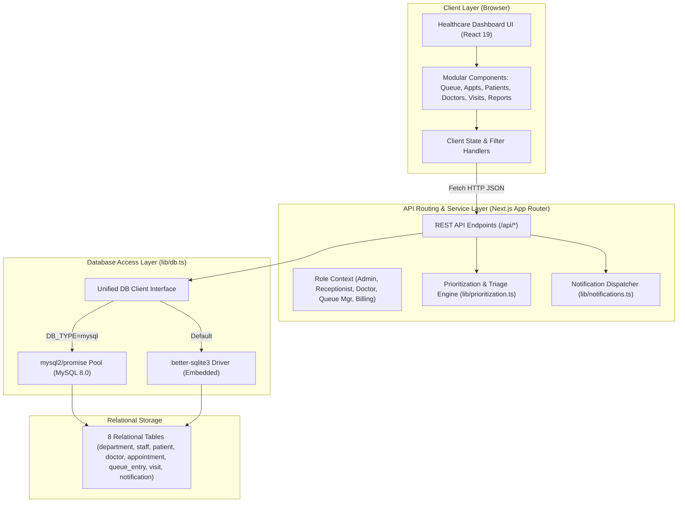
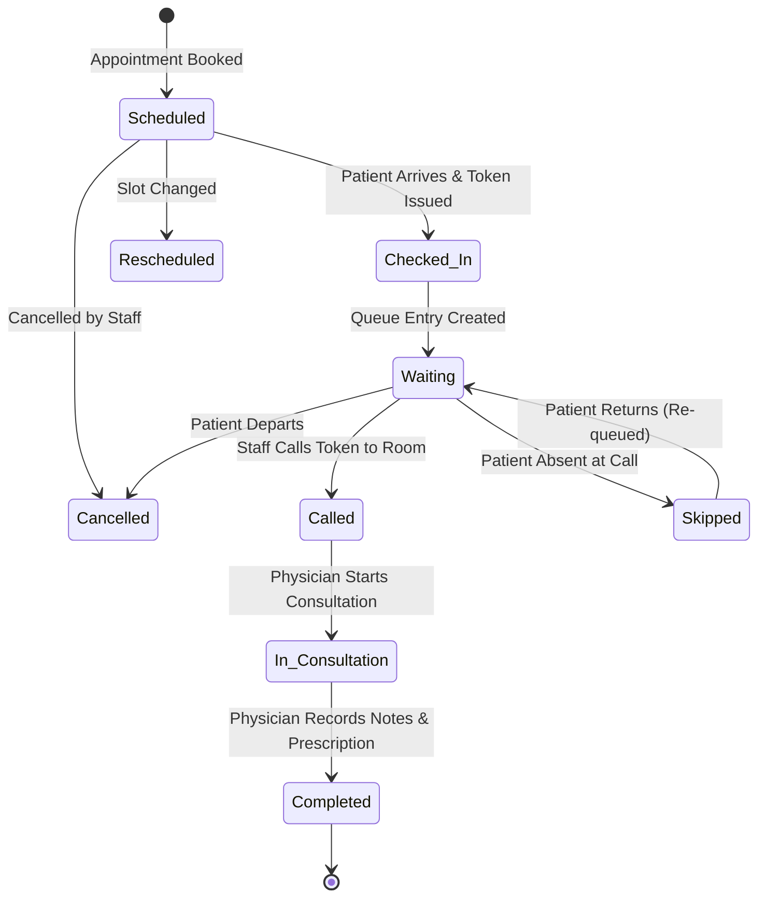

# QueueCare — System Architecture & Design Documentation

**Course:** Database Management Systems (UE24CS352B) | Semester V  
**Institution:** PES University, Bangalore  
**Authors:** Pramath Ganesh Hegde (`PES2UG24CS648`) & Dhruva Ganesh Hegde (`PES2UG24CS671`)

---

## 1. High-Level Architecture

QueueCare is designed following the **Layered Clean Architecture** pattern on Next.js 16 App Router. The architecture decouples client-side user presentation, RESTful API routing, business and prioritization logic, and persistent relational data storage.

---

## 2. Queue Prioritization & Dynamic Triage Algorithm

QueueCare replaces arbitrary First-Come-First-Served (FCFS) waiting lists with a multi-factor clinical urgency prioritization model.

### 2.1 Urgency Tiers & Precedence
1. **Tier 1: Emergency (Rank 1)**
   - Precedence: Highest immediate priority.
   - Triggers: Explicit clinical emergency flag or keywords detected during intake (*"chest pain"*, *"cardiac arrest"*, *"unconscious"*, *"severe trauma"*, *"stroke"*, *"respiratory distress"*).
   - Behavior: Estimated wait time is set to **0 minutes** (immediate physician alert and bypass to examination room).
2. **Tier 2: Urgent (Rank 2)**
   - Precedence: High priority.
   - Triggers: Acute conditions (*"high fever"*, *"fracture"*, *"severe pain"*, *"deep laceration"*, *"asthma attack"*).
   - Behavior: Placed ahead of all routine OPD patients.
3. **Tier 3: Senior Citizen (Rank 3)**
   - Precedence: Elevated priority.
   - Triggers: Automatically evaluated from patient `date_of_birth` where $\text{Age} \ge 60$ years.
   - Behavior: Prioritized to minimize prolonged sitting and fatigue for geriatric patients.
4. **Tier 4: Child / Infant (Rank 4)**
   - Precedence: Pediatric priority.
   - Triggers: Patients where $\text{Age} \le 12$ years.
   - Behavior: Prioritized ahead of routine adult consultations.
5. **Tier 5: Normal (Rank 5)**
   - Precedence: Standard Outpatient (OPD).
   - Triggers: Routine checkups, follow-ups, and non-acute consultations.
   - Behavior: Ordered chronologically by token number and appointment slot.

### 2.2 Dynamic Wait-Time Estimation Formula
The estimated waiting time for any waiting patient $p$ consulting doctor $d$ is given by:

$$\text{WaitTime}(p) = \begin{cases} 0 & \text{if } \text{Tier}(p) = \text{Emergency} \\ \sum_{i \in \text{Ahead}(p, d)} T_{\text{consult}}(i) & \text{otherwise} \end{cases}$$

Where:
- $\text{Ahead}(p, d)$ is the set of all active queue entries (`queue_status IN ('Waiting', 'Called')`) ahead of patient $p$ in doctor $d$'s queue.
- $T_{\text{consult}}$ is the estimated duration: **15 minutes** for routine/geriatric/pediatric patients, and **20 minutes** for urgent cases.

### 2.3 Starvation Prevention Mechanism
To prevent routine patients from being indefinitely postponed by subsequent arrivals:
- If a patient in `Normal` tier has waited $\ge 45$ minutes from their recorded `check_in_time`, their sorting weight receives an aging boost, ensuring they advance ahead of newer routine arrivals.

---

## 3. Entity Lifecycles & State Machines

---

## 4. Module Boundaries & Data Flow

1. **Patient Registration (`/api/patients`)**:
   - Ingests demographics, validates date of birth and uniqueness of phone/email.
   - Inserts record into `patient` table and triggers welcome notification.
2. **Appointment Scheduling (`/api/appointments`)**:
   - Validates doctor and department availability.
   - Performs collision check: ensures no existing non-cancelled appointment exists for that doctor at that specific date and time slot.
   - Persists appointment in `appointment` table.
3. **Queue Check-In (`/api/queue`)**:
   - Invoked when the patient checks in on the day of appointment.
   - Evaluates triage via `evaluateTriage()` to categorize urgency.
   - Queries `MAX(token_number)` for that doctor on current date to generate the next monotonic token.
   - Computes dynamic wait time and creates `queue_entry` record.
4. **Clinical Consultation & Visits (`/api/visits`)**:
   - Captures diagnosis, prescription, physician notes, and billed amount.
   - Atomically updates `visit.visit_status = 'Completed'`, `queue_entry.queue_status = 'Completed'`, and `appointment.appointment_status = 'Completed'`.
   - Generates visit summary alert in `notification` table.
5. **Analytics & Reports (`/api/reports`)**:
   - Executes aggregated SQL queries calculating workload by priority tier, department revenue, doctor performance, and peak hours.

---

## 5. Security, Privacy & Integrity Controls

- **SQL Injection Prevention:** 100% of database queries utilize parameterized statements (`?` placeholders).
- **Referential Integrity:** Cascading deletes configured safely: cancelling/deleting an appointment cleans up orphaned queue entries, while department/doctor records are protected by `ON DELETE RESTRICT`.
- **Minimal Data Exposure:** Sensitive contact numbers and emails are validated on the server and never exposed in client bundles.
- **Fail-Safe Persistence:** Automatic database initialization and schema verification on every application startup.

