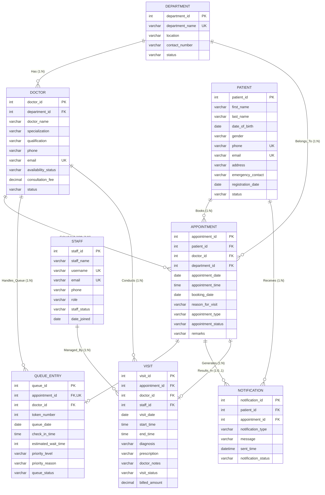

# QueueCare — Database Schema & Data Dictionary

**Course:** Database Management Systems (UE24CS352B) | Semester V  
**Institution:** PES University, Bangalore  
**Authors:** Pramath Ganesh Hegde (`PES2UG24CS648`) & Dhruva Ganesh Hegde (`PES2UG24CS671`)

---

## 1. Relational Schema Overview

QueueCare is designed with a **3NF Normalized Relational Database** consisting of **8 core tables**:
1. `department`
2. `staff`
3. `patient`
4. `doctor`
5. `appointment`
6. `queue_entry`
7. `visit`
8. `notification`

The schema strictly implements all requirements from the PES University DBMS Mini Project specification and matches the official DDL outputs (`DESC` commands).

---

## 2. Entity-Relationship (ER) Diagram



---

## 3. Detailed Data Dictionary

### Table 1: `department`
Stores hospital clinical departments, physical wings, and contact extensions.
| Column | Type | Nullable | Key | Default | Description |
| :--- | :--- | :--- | :--- | :--- | :--- |
| `department_id` | INT | NO | PRI | AUTO_INC | Unique identifier for department |
| `department_name`| VARCHAR(100)| NO | UNI | NULL | Department specialty name (e.g. Cardiology) |
| `location` | VARCHAR(100)| YES | | NULL | Building wing and floor location |
| `contact_number`| VARCHAR(15) | YES | | NULL | Department reception desk extension |
| `status` | VARCHAR(20) | YES | | 'Active' | Operational status |

### Table 2: `staff`
Stores hospital personnel records across administrative, clinical support, and billing roles.
| Column | Type | Nullable | Key | Default | Description |
| :--- | :--- | :--- | :--- | :--- | :--- |
| `staff_id` | INT | NO | PRI | AUTO_INC | Unique staff identifier |
| `staff_name` | VARCHAR(100)| NO | | NULL | Full employee name |
| `username` | VARCHAR(50) | NO | UNI | NULL | Unique login handle |
| `email` | VARCHAR(100)| NO | UNI | NULL | Official hospital email |
| `phone` | VARCHAR(15) | YES | | NULL | Staff mobile contact |
| `role` | VARCHAR(30) | NO | | NULL | Role: `Receptionist`, `Queue Manager`, `Administrator`, `Doctor Assistant`, `Billing Staff` |
| `staff_status` | VARCHAR(20) | YES | | 'Active' | Employment status |
| `date_joined` | DATE | YES | | NULL | Date joined hospital |

### Table 3: `patient`
Stores patient demographic profiles, ages, and emergency contacts.
| Column | Type | Nullable | Key | Default | Description |
| :--- | :--- | :--- | :--- | :--- | :--- |
| `patient_id` | INT | NO | PRI | AUTO_INC | Unique patient identifier |
| `first_name` | VARCHAR(50) | NO | | NULL | Given name |
| `last_name` | VARCHAR(50) | NO | | NULL | Surname |
| `date_of_birth` | DATE | NO | | NULL | Date of birth (used for age/triage) |
| `gender` | VARCHAR(10) | YES | | NULL | Gender |
| `phone` | VARCHAR(15) | YES | UNI | NULL | Primary contact phone |
| `email` | VARCHAR(100)| YES | UNI | NULL | Primary email |
| `address` | VARCHAR(255)| YES | | NULL | Residential address |
| `emergency_contact`| VARCHAR(15)| YES| | NULL | Emergency relative phone |
| `registration_date`| DATE | NO | | NULL | Intake registration date |
| `status` | VARCHAR(20) | YES | | 'Active' | Account status |

### Table 4: `doctor`
Stores consulting medical specialists and clinic affiliations.
| Column | Type | Nullable | Key | Default | Description |
| :--- | :--- | :--- | :--- | :--- | :--- |
| `doctor_id` | INT | NO | PRI | AUTO_INC | Unique physician ID |
| `department_id` | INT | NO | FK | NULL | Reference to `department(department_id)` |
| `doctor_name` | VARCHAR(100)| NO | | NULL | Full doctor name |
| `specialization`| VARCHAR(100)| YES | | NULL | Sub-specialty expertise |
| `qualification` | VARCHAR(150)| YES | | NULL | Medical degrees (MBBS, MD, DM) |
| `phone` | VARCHAR(15) | YES | | NULL | Doctor clinic extension |
| `email` | VARCHAR(100)| YES | UNI | NULL | Doctor hospital email |
| `availability_status`| VARCHAR(20)| YES| | 'Available'| `Available`, `On Break`, `Off Duty` |
| `consultation_fee`| DECIMAL(10,2)| YES| | NULL | Baseline consultation fee (INR) |
| `status` | VARCHAR(20) | YES | | 'Active' | Active consulting status |

### Table 5: `appointment`
Tracks outpatient bookings, scheduled timings, and statuses.
| Column | Type | Nullable | Key | Default | Description |
| :--- | :--- | :--- | :--- | :--- | :--- |
| `appointment_id`| INT | NO | PRI | AUTO_INC | Unique appointment ID |
| `patient_id` | INT | NO | FK | NULL | Reference to `patient(patient_id)` |
| `doctor_id` | INT | NO | FK | NULL | Reference to `doctor(doctor_id)` |
| `department_id`| INT | NO | FK | NULL | Reference to `department(department_id)` |
| `appointment_date`| DATE | NO | | NULL | Scheduled consultation date |
| `appointment_time`| TIME | NO | | NULL | Scheduled slot time |
| `booking_date` | DATE | YES | | CURDATE() | Booking creation date |
| `reason_for_visit`| VARCHAR(255)| YES| | NULL | Chief complaint / symptoms |
| `appointment_type`| VARCHAR(30)| YES| | 'OPD' | `OPD`, `Consultation`, `Follow-up`, `Emergency` |
| `appointment_status`| VARCHAR(20)| YES| | 'Scheduled'| `Scheduled`, `Checked-In`, `In-Progress`, `Completed`, `Cancelled`, `Rescheduled` |
| `remarks` | VARCHAR(255)| YES | | NULL | Administrative staff remarks |

### Table 6: `queue_entry`
Represents daily queue tokens generated when patients check in.
| Column | Type | Nullable | Key | Default | Description |
| :--- | :--- | :--- | :--- | :--- | :--- |
| `queue_id` | INT | NO | PRI | AUTO_INC | Unique queue record ID |
| `appointment_id`| INT | NO | FK,UNI| NULL | Reference to `appointment(appointment_id)` |
| `doctor_id` | INT | NO | FK | NULL | Reference to `doctor(doctor_id)` |
| `token_number` | INT | NO | | NULL | Monotonic token sequence |
| `queue_date` | DATE | NO | | NULL | Date of token generation |
| `check_in_time` | TIME | YES | | NULL | Arrival time |
| `estimated_wait_time`| INT | YES | | 0 | Dynamic wait time estimate (minutes) |
| `priority_level`| VARCHAR(20) | YES | | 'Normal' | `Emergency`, `Urgent`, `Senior Citizen`, `Child/Infant`, `Normal` |
| `priority_reason`| VARCHAR(255)| YES| | NULL | Clinical justification for assigned tier |
| `queue_status` | VARCHAR(30) | YES | | 'Waiting' | `Waiting`, `Called`, `In-Consultation`, `Completed`, `Skipped`, `Cancelled` |

### Table 7: `visit`
Records medical encounter notes, diagnosis, prescriptions, and billing.
| Column | Type | Nullable | Key | Default | Description |
| :--- | :--- | :--- | :--- | :--- | :--- |
| `visit_id` | INT | NO | PRI | AUTO_INC | Unique visit record ID |
| `appointment_id`| INT | NO | FK | NULL | Reference to `appointment(appointment_id)` |
| `doctor_id` | INT | NO | FK | NULL | Reference to `doctor(doctor_id)` |
| `staff_id` | INT | YES | FK | NULL | Reference to `staff(staff_id)` |
| `visit_date` | DATE | NO | | NULL | Date of consultation |
| `start_time` | TIME | YES | | NULL | Consultation start time |
| `end_time` | TIME | YES | | NULL | Consultation conclusion time |
| `diagnosis` | VARCHAR(255)| YES | | NULL | Clinical diagnosis |
| `prescription` | VARCHAR(255)| YES | | NULL | Prescribed medications and dosages |
| `doctor_notes` | VARCHAR(500)| YES | | NULL | Clinical advice and observations |
| `visit_status` | VARCHAR(20) | YES | | 'In Progress'| `In Progress`, `Completed` |
| `billed_amount` | DECIMAL(10,2)| YES| | 0.00 | Consultation fee amount |

### Table 8: `notification`
Logs automated SMS alerts, token calls, and clinical summaries.
| Column | Type | Nullable | Key | Default | Description |
| :--- | :--- | :--- | :--- | :--- | :--- |
| `notification_id`| INT | NO | PRI | AUTO_INC | Unique alert ID |
| `patient_id` | INT | NO | FK | NULL | Reference to `patient(patient_id)` |
| `appointment_id`| INT | YES | FK | NULL | Reference to `appointment(appointment_id)` |
| `notification_type`| VARCHAR(50)| NO | | NULL | Type: `Appointment Confirmation`, `Queue Update`, `Visit Summary`, `General` |
| `message` | VARCHAR(255)| NO | | NULL | Notification text |
| `sent_time` | DATETIME | YES | | NOW() | Timestamp dispatched |
| `notification_status`| VARCHAR(20)| YES| | 'Sent' | `Sent`, `Read` |

---

## 4. Referential Integrity & Constraints

1. **Cascade Deletions:**
   - Deleting a `patient` cascades to delete their `appointment`, `queue_entry`, `visit`, and `notification` records.
   - Deleting an `appointment` cascades to remove its linked `queue_entry` and `visit`.
2. **Restricted Deletions:**
   - `department` records cannot be deleted if active `doctor` or `appointment` records reference them (`ON DELETE RESTRICT`).
   - `doctor` records cannot be deleted if assigned to active appointments or visits (`ON DELETE RESTRICT`).
3. **Check Constraints:**
   - `staff.role` is constrained to: `'Receptionist'`, `'Queue Manager'`, `'Administrator'`, `'Doctor Assistant'`, `'Billing Staff'`.

---

## 5. Performance Indexes

```sql
CREATE INDEX idx_queue_date_status ON queue_entry(queue_date, queue_status);
CREATE INDEX idx_app_date ON appointment(appointment_date, appointment_status);
CREATE INDEX idx_doctor_dept ON doctor(department_id);
```

