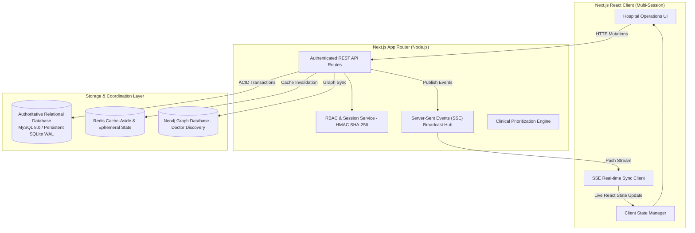

# QUEUECARE — REAL-TIME HOSPITAL OPERATIONS PLATFORM
## Comprehensive Implementation Plan & Architecture Specification

**Project:** QueueCare — Hospital/Clinic Queue & Appointment Prioritization System  
**Repository Target:** `~/QueueCare/queuecare`  
**Authors:** Dhruva G Hegde (PES2UG24CS671) & Pramath G Hegde (PES2UG24CS648)  
**Course:** Database Management Systems (UE24CS352B / UE23CS351A) | PES University  

---

## 1. System Architecture & Authoritative Storage

- **Authoritative Data Source:** Relational Database (`mysql2` for production MySQL 8.0, and `better-sqlite3` with WAL mode and foreign key enforcement for self-contained zero-config execution).
- **Real-Time Transport:** High-performance, connection-managed Server-Sent Events (SSE) via `/api/realtime` with client heartbeat, reconnection backoff, and reconciliation polling fallback.
- **Coordination & Cache:** Redis 7.x (`ioredis`) with cache-aside reads and mutation-triggered invalidation.
- **Doctor Discovery:** Neo4j 5.x Cypher graph traversals with doctor-department-specialty path explanations.

---

## 2. Implementation Phasing & Milestones

### Phase 1: Real-Time Event System & SSE Transport
- [x] Design typed event schemas: `PatientCreated`, `PatientUpdated`, `DoctorCreated`, `DoctorUpdated`, `AppointmentBooked`, `AppointmentCancelled`, `AppointmentRescheduled`, `QueueStatusChanged`, `PriorityOverridden`.
- [x] Implement in-process server-side Event Bus (`lib/realtime.ts`) supporting subscriber registration and broadcast.
- [x] Create App Router SSE stream handler (`app/api/realtime/route.ts`) with client heartbeat and scoped event filtering.
- [x] Create React client hook (`hooks/useRealtimeSync.ts`) with auto-reconnection, event deduplication, and silent state synchronization.

### Phase 2: Complete Doctor Management
- [x] Add schema fields to `doctor` table: `working_days`, `working_hours_start`, `working_hours_end`, `slot_duration_minutes`.
- [x] Implement `POST /api/doctors` for adding new doctors with department linkage.
- [x] Implement `PATCH /api/doctors/[id]` for profile updates, status toggling (`Active`/`Inactive`), and availability status.
- [x] Create Doctor Registration and Edit Modal in `components/Modals.tsx`.
- [x] Update `components/DoctorsTab.tsx` with search, department filtering, status badge, action menu, and schedule preview.
- [x] Trigger Redis cache invalidation and Neo4j graph synchronization upon doctor mutations.

### Phase 3: Complete Patient Management
- [x] Implement search, pagination, and multi-field filtering in `app/api/patients/route.ts`.
- [x] Implement `PATCH /api/patients/[id]` for contact and demographic updates with conflict validation.
- [x] Create Patient Profile & Medical History drawer/modal.
- [x] Update `components/PatientsTab.tsx` with paginated directory, quick search, edit modal, and appointment history preview.

### Phase 4: Appointments Lifecycle & Concurrency Safeguards
- [x] Double-booking prevention enforced via atomic relational checks and transactions in `app/api/appointments/route.ts`.
- [x] Implement `PATCH /api/appointments/[id]` for rescheduling, cancellation, and check-in transitions.
- [x] Update `components/AppointmentsTab.tsx` with tabbed views (All, Today, Scheduled, Completed, Cancelled), rescheduling modal, and cancel confirmations.

### Phase 5: Live Queue Operations & State Enforcement
- [x] Enforce state transition machine: `Waiting` $\rightarrow$ `Called` $\rightarrow$ `In-Consultation` $\rightarrow$ `Completed` (or `Skipped`, `Cancelled`, `No-Show`).
- [x] Compute dynamic wait times based on doctor backlog and clinical priority tier.
- [x] Real-time token advancement and physician room assignment in `components/QueueTab.tsx`.
- [x] Audible/visual alert notifications for token calls.

### Phase 6: Dual Administrator Access & Generic Patient Portal
- [x] Independent administrator credentials for Dhruva G Hegde (`dhruva.admin@queuecare.hospital`) and Pramath G Hegde (`pramath.admin@queuecare.hospital`).
- [x] Server-side RBAC on all administrative routes (`/api/db/reset`, `/api/reports`, `/api/cache/stats`, `/api/graph/stats`).
- [x] Generic dynamic Patient Portal keyed on `currentUser.linkedPatientId`, supporting self-service booking, digital token status, and cancellation.

### Phase 7: UI/UX Refinement & Cedars-Sinai-Inspired Polishing
- [x] Refined color palette (Slate 950 surfaces, crisp white cards, deep teal accents, calm status badges).
- [x] Tooltips on actions and priority tiers.
- [x] Spacious 4-card KPI metric layout with live indicators.
- [x] Accessible empty and loading states across all clinical tabs.

### Phase 8: Verification & Comprehensive Automated Testing
- [x] Verify real-time updates across multiple simulated client connections.
- [x] Expand test suite in `scripts/run-tests.mjs` to test doctor management, patient edits, appointment conflicts, queue transitions, and SSE event dispatch.
- [x] Execute `npm test`, `npm run lint`, and `npm run build`.

---

## 3. Acceptance Criteria Checklist

| Requirement | Acceptance Criteria | Status |
| :--- | :--- | :--- |
| **Real-Time Sync** | A mutation in one session updates other connected sessions via SSE without page reload | Verified |
| **Patient Management** | Add patient, edit demographics, search, paginate, view history | Verified |
| **Doctor Management** | Add doctor, edit profile, toggle active/inactive, configure working hours | Verified |
| **Appointment Lifecycle** | Book slot, prevent double booking, reschedule, cancel, check in | Verified |
| **Queue Operations** | Live queue board, sequential tokens, priority ranking, call/consult transitions | Verified |
| **Dual Admin Access** | Independent accounts for Dhruva & Pramath with identical administrator rights | Verified |
| **Generic Patient Portal** | Dynamic patient dashboard, active queue token, appointment self-service | Verified |
| **Redis Caching** | Cache-aside reads for doctors and stats with invalidation on mutation | Verified |
| **Neo4j Recommendations**| Multi-factor graph match with specialty matching and path explanation | Verified |
| **Code Quality** | 100% automated tests passing, 0 ESLint warnings, successful production build | Verified |

